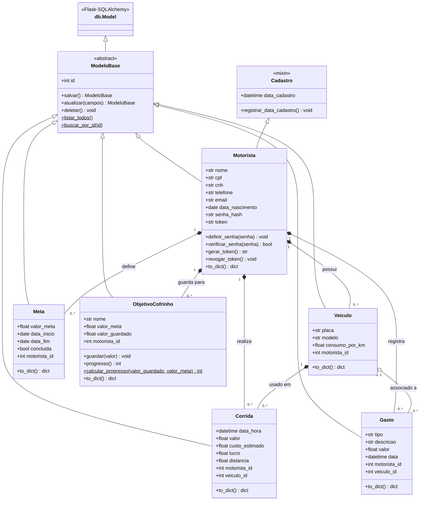

# Diagrama de classes do domínio

Diagrama das classes implementadas em `backend/models/` e dos relacionamentos entre elas.
As Models herdam de `ModeloBase`, que herda de `db.Model` (Flask-SQLAlchemy): o CRUD é feito com o ORM e os
relacionamentos são declarados com `db.relationship`. A estrutura das tabelas gerada a partir delas está em `backend/schema.sql`.
O GitHub renderiza o diagrama abaixo automaticamente (sintaxe Mermaid).

## Legenda dos relacionamentos

| Relacionamento | Tipo | Observação |
|---|---|---|
| `Motorista` → `Veiculo`, `Corrida`, `Meta`, `Gasto`, `ObjetivoCofrinho` | Composição (1 para N) | `db.relationship(..., cascade="all, delete-orphan")` em `Motorista` e chave estrangeira com `ON DELETE CASCADE`: ao excluir o motorista, seus registros são excluídos. |
| `Veiculo` → `Corrida` | Composição (1 para N) | `Veiculo.corridas` com `cascade="all, delete-orphan"` e `ON DELETE CASCADE`: ao excluir o veículo, suas corridas são excluídas. |
| `Veiculo` → `Gasto` | Agregação (0..1 para N) | `Gasto.veiculo_id` é opcional e o relacionamento `Veiculo.gastos` não tem cascade de exclusão (chave estrangeira `ON DELETE SET NULL`): ao excluir o veículo, o gasto continua existindo sem veículo. |
| `ModeloBase` → todos os Models | Herança | Classe base abstrata (`__abstract__ = True`, herda de `db.Model`, não vira tabela) com o `id` e o CRUD feito com o ORM (`salvar`, `atualizar`, `deletar`, `listar_todos`, `buscar_por_id`). |
| `Cadastro` → `Motorista` | Herança (mixin) | Acrescenta o campo `data_cadastro` (preenchido por `registrar_data_cadastro()`). Não é tabela própria; a coluna fica na tabela `motoristas`. |

## Onde cada classe está no código

| Classe | Arquivo |
|---|---|
| `ModeloBase` | `backend/models/base.py` |
| `Cadastro` | `backend/models/cadastro.py` |
| `Motorista` | `backend/models/motorista.py` |
| `Veiculo` | `backend/models/veiculo.py` |
| `Corrida` | `backend/models/corrida.py` |
| `Meta` | `backend/models/meta.py` |
| `Gasto` | `backend/models/gasto.py` |
| `ObjetivoCofrinho` | `backend/models/objetivo_cofrinho.py` |
